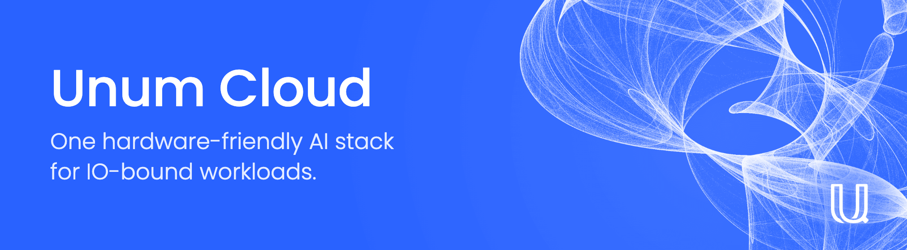

<a href="https://www.unum.cloud/docs">Docs</a> ·
<a href="https://www.unum.cloud/blog">Blog</a> ·
<a href="https://discord.gg/4mxGrenbNt">Discord</a> ·
<a href="https://www.youtube.com/@unum-cloud">YouTube</a> ·
<a href="https://x.com/unum_cloud">X</a> ·
<a href="https://www.linkedin.com/company/unum-cloud">LinkedIn</a>

Unum builds search, storage, networking & multimodal engines from the hardware up.
They keep data in RAM, VRAM or on NVMe, run on x86, Arm & RISC-V CPUs and NVIDIA, AMD & Apple GPUs, and ship stable C ABIs with bindings for over a dozen languages.

- __[USearch](https://github.com/unum-cloud/USearch)__: one proximity graph for vectors, sequences, shapes & geospatial sets.
- __[UStore](https://github.com/unum-cloud/UStore)__: transactional database for blobs, documents & graphs on NVMe & GPUs.
- __[UCall](https://github.com/unum-cloud/UCall)__: low-latency client-server engine on io_uring, Noise encryption & SIMD.
- __[UForm](https://github.com/unum-cloud/UForm)__: distributed training & inference for multimodal shared embeddings.

Underneath sit four kernel libraries: [StringZilla](https://github.com/ashvardanian/StringZilla) for strings, [NumKong](https://github.com/ashvardanian/NumKong) for mixed-precision math, [ForkUnion](https://github.com/ashvardanian/ForkUnion) for NUMA-aware parallelism, and [SmashTable](https://github.com/ashvardanian/SmashTable) for transactional containers.
The same stack, adapted to scientific & scholarly computing, lives in [Unum Science](https://github.com/unum-science).
